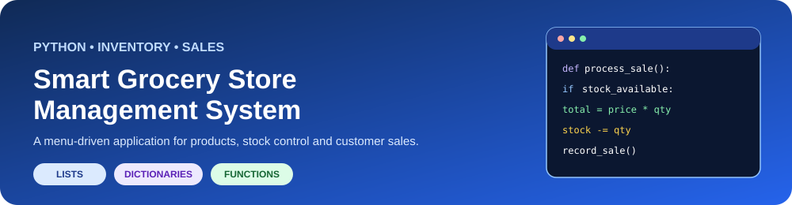
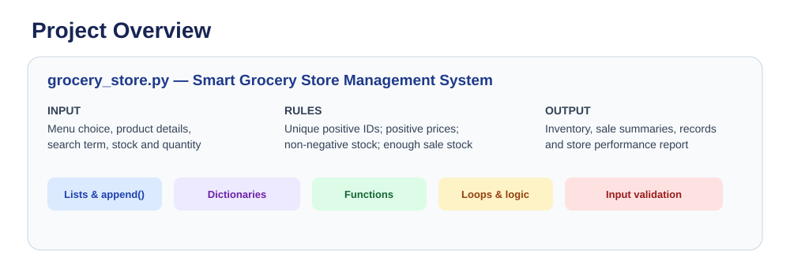
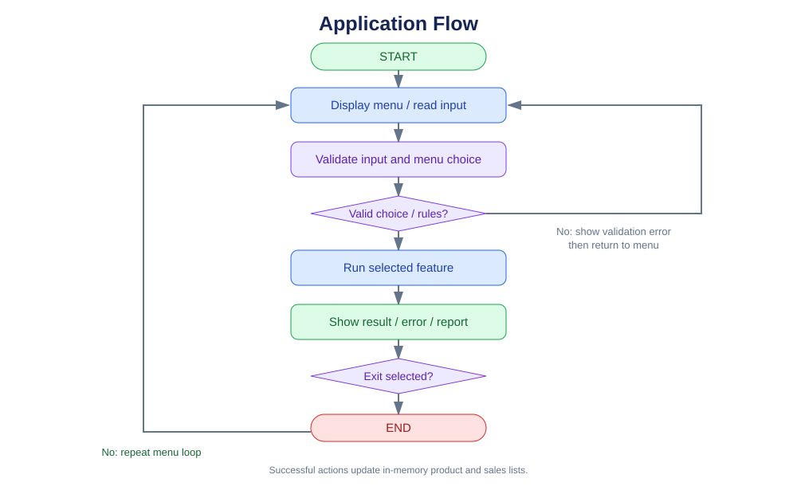
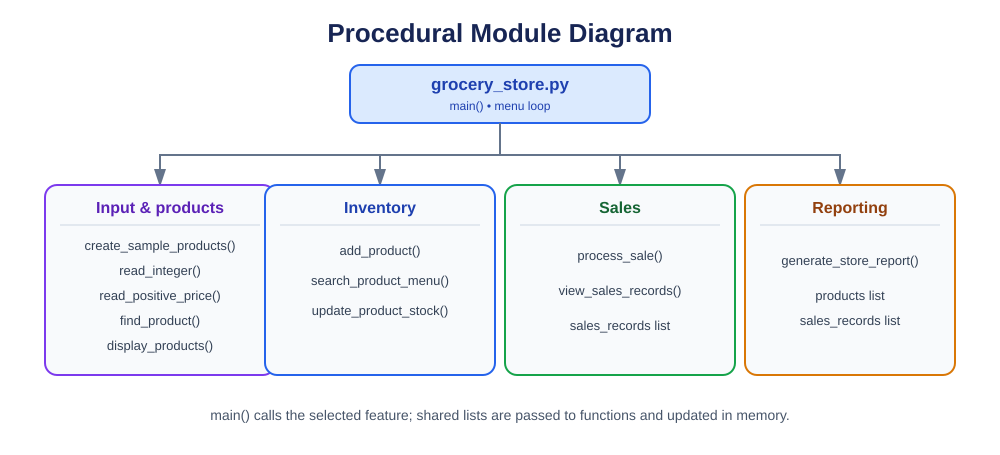

<p align="center"></p>

# Smart Grocery Store Management System

## 1. Project Overview

A beginner-level, menu-driven Python application for managing a small grocery shop. It maintains product inventory, processes customer purchases, stores completed sales in memory, and produces a store report.

| Task | File | Topic |
|---|---|---|
| Grocery store management (8 menu features) | `grocery_store.py` | Lists, dictionaries, functions, loops, conditions and input validation |



## 2. Folder Structure

```text
smart-grocery-store-management/
├── grocery_store.py
├── README.md
└── assets/
    ├── banner.svg
    ├── banner.png
    ├── overview.svg
    ├── overview.png
    ├── grocery_store_flow.svg
    ├── grocery_store_flow.png
    ├── uml_diagram.svg
    └── uml_diagram.png
```

The `assets/` folder is an additional documentation-only folder for diagrams and PNG previews. The application itself uses only the Python standard library.

## 3. Grocery Store Management

### Summary

The program starts with Milk, Bread, Rice and Eggs. Users can add products, view and search inventory, update stock, process sales, view sales records, and generate a report. Product and sales data are stored in lists of dictionaries and reset when the program exits.

### Rules or Requirements

- Every product has an ID, name, category, price and stock quantity.
- Product IDs must be positive and unique.
- Product names and categories cannot be empty.
- Prices must be numeric and greater than zero.
- Stock cannot be negative; stock additions and sale quantities must be positive.
- A sale completes only when the product exists and enough stock is available.
- Only completed sales are added to `sales_records`.
- Low stock means fewer than five units.

### Program Flow



### Code Methods Description

| Method or section | Purpose |
|---|---|
| `create_sample_products()` | Creates the four required starting products. |
| `read_integer()` | Validates whole-number input and optional minimum values. |
| `read_positive_price()` | Accepts numeric prices greater than zero. |
| `find_product()` | Searches by numeric ID or full/partial name. |
| `display_products()` | Prints product details in a table. |
| `add_product()` | Validates and appends a unique product dictionary. |
| `search_product_menu()` | Gets a search term and displays matches. |
| `update_product_stock()` | Adds units or sets a new stock quantity. |
| `process_sale()` | Checks stock, calculates a sale, updates inventory and records it. |
| `view_sales_records()` | Displays completed transactions and revenue. |
| `generate_store_report()` | Calculates inventory, revenue, low-stock and price-range information. |
| `display_menu()` | Displays the eight menu choices. |
| `main()` | Runs the menu loop and dispatches each choice. |

### Input Validation

- `try/except ValueError` handles invalid integer and price input.
- Product IDs and quantities are checked against minimum values.
- Duplicate IDs, blank names/categories and non-positive prices are rejected.
- Sales for missing products or insufficient stock are cancelled without changing inventory.
- Invalid menu choices and stock update options display an error.

### Expected Results

- Adding a valid product displays a success message.
- Searching displays matching details or `No products found.`
- Stock updates show the new quantity.
- A successful sale displays a purchase summary and remaining stock.
- Failed sales do not create a sales record or deduct stock.
- The report displays product count, total stock, transaction count, revenue, low-stock products and highest/lowest priced products.

## 4. UML Diagram

A **procedural module diagram** is used because the program is organized around functions rather than user-defined classes. It shows the main module, function groups and shared in-memory product and sales lists.



## 5. Concepts and Techniques Used

- **Lists:** `products` and `sales_records` store multiple dictionaries.
- **Dictionaries:** named keys organize product and sale information.
- **`append()`:** adds new products and completed sales.
- **Functions:** divide the program into reusable tasks.
- **Loops:** keep the menu running and process collections.
- **Conditions:** handle menu choices, duplicates, missing products and stock checks.
- **Exception handling:** `try/except ValueError` prevents invalid numeric input from crashing the program.
- **List comprehensions and built-ins:** filtering and aggregate operations support searches and reports.
- **In-memory storage:** no file or database is used, as required.

## 6. How to Run

### Requirements

- Python 3.8 or newer recommended.
- No third-party Python packages are required.

### Clone the repository

```bash
git clone https://github.com/muzammalali08765/smart-grocery-store-management.git
cd smart-grocery-store-management
```

### Run the program

```bash
python grocery_store.py
```

Alternative commands:

```bash
python3 grocery_store.py
```

On Windows:

```bash
py grocery_store.py
```

## 7. Sample Execution

The following excerpts are captured from actual program runs.

### Successful sale — two units of Milk

```text
--- Purchase Summary ---
Product        : Milk
Product ID     : 101
Quantity       : 2
Unit price     : Rs. 250.00
Total amount   : Rs. 500.00
Remaining stock: 18
```

### Failure — requested quantity exceeds available stock

```text
Error: Insufficient stock. Available quantity: 20. Sale cancelled.
```

## 8. Test Cases

These cases were executed by running the actual program with the listed terminal input sequences.

### Grocery Store Management Tests

| # | Scenario | Inputs | Expected result |
|---:|---|---|---|
| 1 | View initial products | `2`, `8` | Four sample products are displayed. |
| 2 | Successful sale of two Milk units | `5`, `101`, `2`, `6`, `7`, `8` | Total is Rs. 500.00; Milk stock becomes 18; records/report update. |
| 3 | Duplicate ID then valid product | `1`, `101`, `105`, `Apples`, `Fruit`, `80`, `0`, `2`, `8` | Duplicate is rejected; Apples is added with zero opening stock. |
| 4 | Invalid ID, price and stock | `1`, `abc`, `106`, `Banana`, `Fruit`, `-2`, `60`, `-1`, `5`, `8` | Invalid values are rejected; valid values are accepted. |
| 5 | Insufficient stock | `5`, `101`, `21`, `2`, `8` | Sale is cancelled; stock is unchanged. |
| 6 | Unknown product | `5`, `999`, `8` | Product-not-found error; sale cancelled. |
| 7 | Partial-name search | `3`, `ri`, `8` | Rice is found. |
| 8 | Set stock to zero | `4`, `102`, `2`, `0`, `7`, `8` | Bread stock becomes zero and appears in low-stock report. |
| 9 | Invalid menu option | `9`, `8` | Error appears; menu continues. |
| 10 | Zero sale quantity | `5`, `101`, `0`, `1`, `8` | Zero is rejected; next valid quantity is accepted. |
| 11 | Zero price | `1`, `107`, `Oranges`, `Fruit`, `0`, `55`, `5`, `8` | Zero price is rejected; valid price is accepted. |
| 12 | Blank name and category | `1`, `108`, blank, `Orange`, blank, `Fruit`, `20`, `3`, `8` | Blank fields are rejected; valid values are accepted. |

## Submission Notes

- Product and sales data are held in memory and reset when the application closes.
- No database, CSV file or external package is required.
- The program remains procedural and beginner-friendly.

---

**Author:** Muzammal Ali  
**GitHub:** [muzammalali08765](https://github.com/muzammalali08765)  
**Repository:** [smart-grocery-store-management](https://github.com/muzammalali08765/smart-grocery-store-management)
